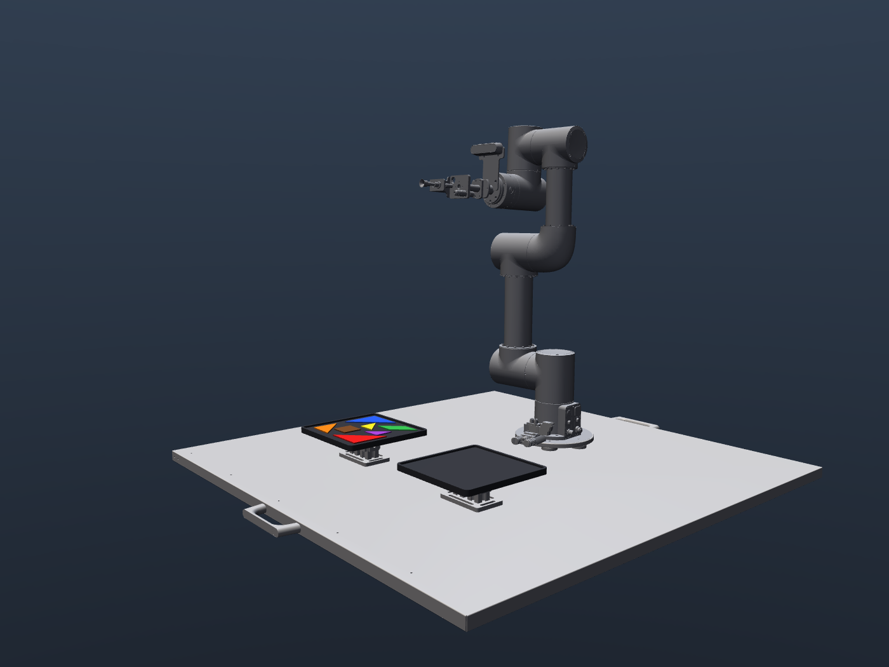
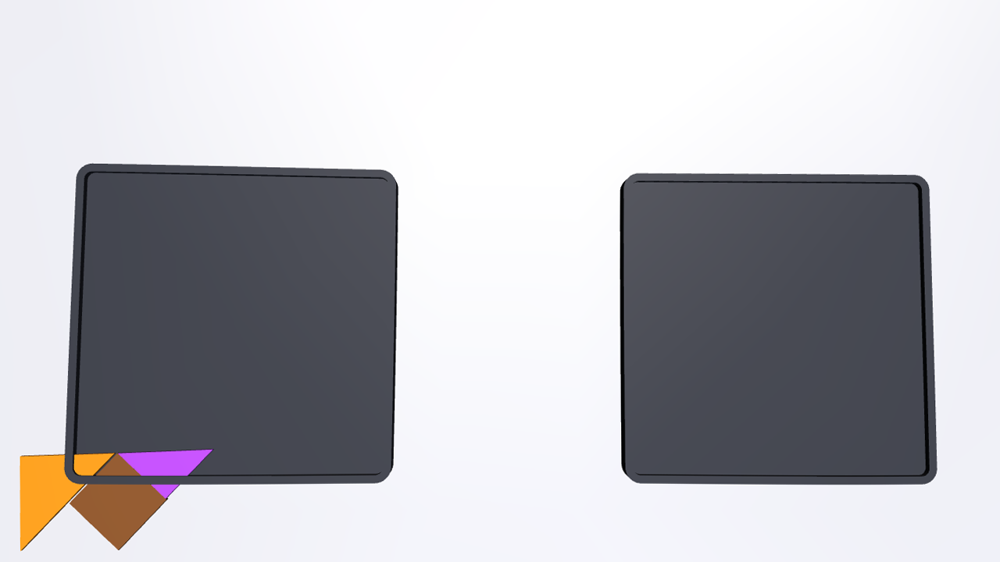
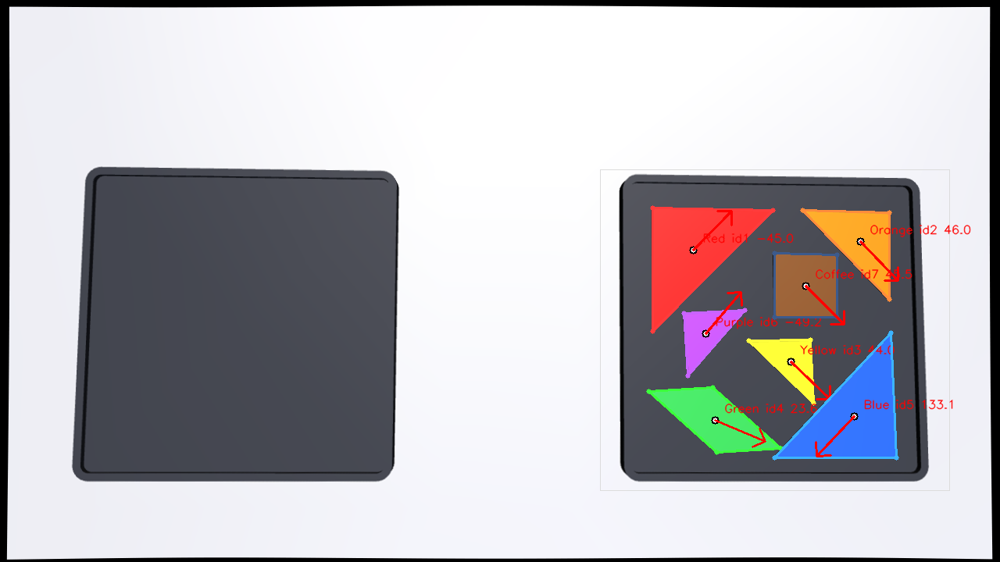
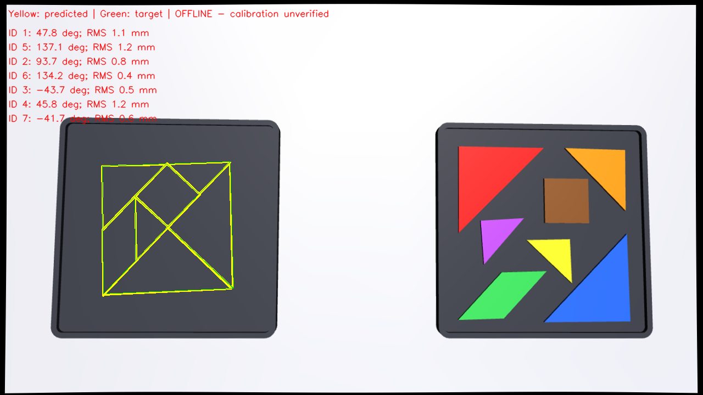

# ICIM Tangram Sim — 七巧板工位的 MuJoCo 仿真平台

> 仓库名 `icim-tangram-sim`，Python 包名仍是 `icim_sim`（代码里的 `import icim_sim` 不变）。
> 配套的工作间仓库（STEP → 场景生成工具链）：[`icim-tangram-workshop`](https://github.com/michall70/icim-tangram-workshop)

> **English TL;DR** — A MuJoCo digital-twin of a tangram-assembly robot cell. The
> robot program written for the real cell (a partner team's `main.py`) runs here
> **unmodified**: the platform swaps the hardware classes at import time, derives
> every calibration constant from the CAD/STEP model, and records reproducible
> evidence (24 self-checks, placement error, replay). No ROS, no Docker, plain
> Python + MuJoCo on Windows.
>
> Quick start: `pip install -r requirements.txt` → `python verify.py` → `python demo.py`.



跑完一次完整拼装（七块板自动搬过去、拼成正方形，落点最大偏差 0.82 mm）：



| 原料七块识别 | 目标图案 → 规划落位 |
|---|---|
|  |  |

**这个仓库是比赛项目里的"仿真平台"部分**：算法（检测、匹配、规划）由队友的
`main.py` 提供，平台负责让它**不改一行代码**就跑起来，并给出可复现的证据。

把**你们的机器人程序**放到这个仿真里跑，不用改你们一行代码。
所有几何来自比赛 STEP 模型；相机、板面高度、单应矩阵、抓放姿态都由模型算出来。

### 克隆下来能直接跑什么

| 命令 | 需要队友代码吗 | 说明 |
|---|---|---|
| `python verify.py` | **不需要** | 24 条自检：几何/物理/相机/吸盘/布局 |
| `python demo.py` | **不需要** | 自动抓一块板放到目标托盘，误差 0.00 mm |
| `python play.py` | **不需要** | 手玩沙盒（滑条 + 吸盘 + 3D + 腕相机） |
| `python run.py` | 需要 | 跑队友的完整流程。把他们的仓库放到 `third_party/<名字>/` 即可（平台按内容自动识别，不看目录名）；`python run.py --list` 会告诉你认到了什么 |

```
icim_sim/
  run.py        跑你们的 main.py（全流程抓放）；--target 换目标图案
  demo.py       不需要你们代码，演示一次抓放
  verify.py     24 条验收：确认仿真里的数都对得上 STEP
  play.py       手玩沙盒：六根滑条 + 吸盘 + 3D 视图 + 腕相机
  icim_sim/     包本体（robot / camera / calib / cell / devices / replay /
                target（画目标图案）/ chirality（平行四边形自动翻面））
  assets/       scene.xml + 网格（44 MB，从 STEP 生成，不用你们准备）
  third_party/  把你们的仓库放这里
  runs/         运行产物（图片、录像、规划结果）
```

## 1. 装

Windows + Python 3.11~3.13（在 3.13.7 上测过）：

```powershell
python -m venv .venv
.venv\Scripts\python.exe -m pip install -r requirements.txt
```

## 2. 先确认仿真本身是活的（不用你们的代码）

```powershell
.venv\Scripts\python.exe verify.py      # 24 条验收，应当全 PASS
.venv\Scripts\python.exe demo.py        # 吸一块板放到目标盘，误差 0.00 mm
.venv\Scripts\python.exe play.py        # 手玩沙盒，见下
```

### `play.py`：手玩沙盒（不用写代码就能玩）

两个窗口：MuJoCo 3D 视图 + 控制台（六根滑条、吸盘按钮、腕相机画面、法兰位姿）。

| 操作 | 作用 |
|---|---|
| 拖滑条 / 选中后按方向键 | 单独转某一个关节（限速 150°/s，松手就停） |
| 按钮或 `s` | 吸盘吸 / 放（**对准 + 贴住**才吸得住，歪了远了都会在状态下打印原因） |
| `n` 或「重新撒开」 | 把七块板在原料盘上**随机撒开**（互不重叠，可复现） |
| `r` | 全部复位（六个关节 + 七块板，回到当前布局） |
| `Tab` 或「摆位」 | 进入**摆位模式**：自动关重力，`Tab` 轮选七块板（选中的变白） |
| 摆位中：方向键 / `Shift`+方向键 | 平移 1 mm / 10 mm |
| 摆位中：`,` `.` / `Shift`+`,` `.` | 转 ∓15° / ∓45° |
| 摆位中：`[` `]` | 升降 1 mm（放高一点再让它落下来） |
| 摆位中：`Esc` | 退出摆位（恢复重力） |
| `Ctrl+S` / 「存布局」 | 把当前七块板 + 六个关节存成布局 |
| `Ctrl+Shift+S` / 「另存为」 | 存成新名字 |
| `Ctrl+L` / 「读布局」 | 读回默认布局 |
| `g` | 重力开关 |
| `p` | 打印当前六个关节角 + 法兰位姿，可直接贴进代码 |

3D 窗口里：左键拖=转视角，中键拖=平移，滚轮=缩放，Ctrl+右键拖=给物体外力。

### 初始布局：`layouts/` 下可以有多份

一套"初始位姿" = 七块板的位置 + 六个关节角，存在 `layouts/<名字>.json`：

```json
{
  "robot_joint_deg": [-98.3, -110.0, -30.5, -140.1, 90.0, 90.0],
  "pieces": {
    "piece_large_1": {"x": -112.96, "y": -496.26, "yaw": 0.0}
  }
}
```

`yaw` 是**相对 CAD 朝向**的转角（0 = 模型里那样），位置是基座系 mm。

选哪份（优先级从上到下）：

1. 命令行 `--layout 名字`：`run.py` / `play.py` / `demo.py` 都支持
2. `layouts/active.txt` 里写的一行名字
3. `layouts/default.json`（出厂那份）
4. 只有一份 → 就是它

看有哪些：

```powershell
python run.py --list-layouts
```

**三个入口用的是同一份**：`run.py` 在他们 `robot.connect()` 时就套用，所以他们的程序一取图，
板子已经在布局位置上；`play.py` 每次「回 HOME」套用；`demo.py` 启动时套用。
不想用布局就 `--layout none`。

摆好一套的流程：

1. `play.py` → `Tab` 进入摆位 → `Tab` 选板、方向键挪、`,`/`.` 转、`[`/`]` 升降；
2. `Ctrl+Shift+S` 存成 `layouts/我的.json`；
3. `python run.py --layout 我的` —— 他们的程序就在这套摆位上跑。

`start_pose.json`（包根目录）仍然管用，只管六个关节，优先级低于布局里的 `robot_joint_deg`。

`verify.py` 是**验收标准**，不是单元测试。它查的是"仿真里看到的东西凭什么可信"：

| 组 | 查什么 |
|---|---|
| A 装配 | nq=56、njnt=14（6 铰链 + 1 滑轨 + 7 自由板）、关节命名 |
| B 几何 | 法兰→吸盘口 252.515 mm、板面高度、七块板面积比 4:4:2:1:1:2:2、总面积 13540 mm² |
| C 物理 | 板子落定下沉 < 0.3 mm、从 110 mm 掉下来落在托盘上不穿模 |
| D 相机 | 在 RGB 模块成像面上、拍照姿态光轴竖直、fy=910.39、**两块托盘都完整在画面内** |
| E 联动 | 拍照位可逆解、吸盘对准才吸、偏 30 mm / 高 30 mm 不吸 |
| F 布局/快照 | 布局存-读往返无误差、`third_party` 能认出快照并按规则选中 |

## 3. 接你们的程序

`third_party/` 下**可以放任意多份**队友代码（每份一个子目录，名字随便）：

```
third_party/20261101/     ← 交付包自带这份（只含 .py 代码，11-01 快照）
third_party/20261030/     ← 上一版，留着对比
third_party/active.txt    ← 一行：默认用哪份
```

```powershell
python run.py --list                  # 看有哪些、认出几项
python run.py --team-repo 20261101    # 用指定那份
python run.py --set-active 20261101   # 设成默认
```

多份且没指定、也没有 `active.txt` 时，会**列出来让你选**，不会乱猜。
仿真不假设你们的目录叫什么：它按**内容**找 `class CobotClient`、`class RealSenseCamera`、
`main.run()`，认到的结果会先打印一张表（认错了可以用 `team_layout.json` 手工指定）。
然后：

```powershell
.venv\Scripts\python.exe run.py              # 无头算完（约 30 s）→ 自动回放整段搬运
.venv\Scripts\python.exe run.py --no-replay  # 只算不回放（批量跑、只看数）
.venv\Scripts\python.exe run.py --dry-run    # 只取图+检测+规划，不动机械臂
.venv\Scripts\python.exe run.py --target D:\图案\my.png   # 换目标图案图片（见 3.1）
.venv\Scripts\python.exe run.py --target-source photo     # 回退到"相机模板照片"旧链路
.venv\Scripts\python.exe run.py --viewer     # 边跑边看（真机速度；能不能跑满看机器）
.venv\Scripts\python.exe run.py --cam-window # 回放时另开一个腕相机窗口（很吃资源）
.venv\Scripts\python.exe run.py --team-repo D:\path\to\repo   # 换路径
```

### 3.1 目标图案：比赛给的那张图

队友现在的主方案是 **`TARGET_SOURCE="image"`：读一张彩色图案图片**（不是拍照片）。
仿真这边默认用 `runs/target_sim.png`——我们按模型尺度**画**出来的经典正方形
（`icim_sim/target.py`，七块纯色、白底、无描边），第一次跑自动生成。

换成任意一张图：

```powershell
.venv\Scripts\python.exe run.py --target D:\图案\my.png
```

图必须让他们的 `planning/target_image.py` 认得出（否则会直接报错，报错信息就是原因）：

| 要求 | 不满足会怎样 |
|---|---|
| **七块、七种互不相同的纯色填充** | 同色并成一块 → `解析出 N 块，应为 7 块` |
| 白底、**无描边 / 阴影 / 渐变** | 一块被切成多块 → 同上报错 |
| 标准七巧板比例（面积偏差 ≤ 8%） | `面积与件库相差 x%` |
| 尺寸/像素多少、有没有托盘都无所谓 | 程序只取形状，按 `S_PHYS_MM` 缩放到实物大小 |

图案会**对齐到目标托盘中心**、保持图片自身朝向（放不下才自动转到与托盘平行）。
能装下的最大图形由托盘垫片决定：仿真里垫片 260×260 mm，实测 232.9 mm 宽的三角形也能过。

**平行四边形手性会自动处理**：换目标图以后，如果图案需要那块板翻面，仿真会在开局
把它翻过来（判据用的是他们自己的 `plan_puzzle` 的 `suspected_flip`，见 `icim_sim/chirality.py`），
所以不会因为"手性不符"卡住。

**回放操作**

| 操作 | 作用 |
|---|---|
| 按 `1`–`9` | 直接设成 1×–9× 播放 |
| 按 `0` | 0.5× |
| 按 `+` / `-` | 在当前倍速上加减 1× |
| 拖鼠标 | 转视角（回放时随时可看） |
| 关窗口 | 结束 |

（先点一下控制台窗口，键盘才吃得到。`--replay-speed 2` 可以直接指定起始倍速。）

**为什么默认"先算后放"**：MuJoCo 一边算一边渲染时，渲染会把时间吃光（无窗口 30 s 的一段，
带窗口要两分多钟）。所以默认无头把全程算完（约 30 s，9 s 仿真时间），再在窗口里按
50 fps 回放（一圈 9 s，循环到关窗口）。

**想看相机拍到什么**：`--cam-window` 会多开一个腕相机窗口（两个 GL 窗口很吃资源，
实测能把机器拖卡，所以默认关）。更省事的办法是直接看流水线存下来的图：

| 文件 | 内容 |
|---|---|
| `runs/dry/raw.png` | `--dry-run` 拍的那张**未去畸变**原图（他们就吃这种） |
| `runs/dry/raw_annotated.png` | 原料七块的检测标注（ID / 形状 / 角度 / 抓取点） |
| `runs/dry/plan_preview.png` | 规划预览：黄=预测落位，绿=目标槽位 |
| `runs/dry/plans.json` | 七条抓放计划（和 `--dry-run` 同一次） |
| `runs/after.png` | 全部摆完后的成品图，**在拍照位拍、带镜头畸变**，可直接和 `raw_frame.png` 对比 |
| `runs/results/<时间戳>/` | 他们 `main` 每次跑出来的原始产物（含 `plans.json`、`raw_frame.png`） |

`run.py` 会打印**它替你改了什么**：单应矩阵、拍照位、抓放高度、两个 ROI、抓放姿态、
目标图通道（锚点 / 可用区 / `S_PHYS_MM`），以及每项改前改后的数。
这些是"工位标定"，不是你们的算法——见 `docs/API.md`。

## 4. 命令行总表（只在这里维护，各文件开头不再重复）

| 命令 | 作用 |
|---|---|
| `python run.py` | 跑他们的全流程，算完自动回放 |
| `run.py --no-replay` | 只算不回放 |
| `run.py --dry-run` | 只取图+检测+规划，不动机械臂（走他们自己的离线分支） |
| `run.py --target 图片` | 换目标图案（默认 `runs/target_sim.png`） |
| `run.py --target-source photo` | 回退到"相机模板照片"旧链路（`--template` 指定那张照片） |
| `run.py --viewer` / `--speed N` | 边跑边看 / 播放倍速 |
| `run.py --replay-speed N` / `--cam-window` | 回放倍速 / 回放时多开腕相机窗口 |
| `run.py --layout 名字` / `--list-layouts` | 换初始布局 / 列出布局 |
| `run.py --team-repo 名字` / `--list` / `--set-active 名字` | 换队友快照 / 列清单 / 设默认 |
| `run.py --gripper-time N` / `--no-lens` | 吸盘等待秒数（仿真默认 0.2）/ 不加镜头畸变 |
| `verify.py` | 24 条验收，确认仿真里的数都对得上 STEP |
| `demo.py` | 不需要他们的代码，演示一次抓放 |
| `play.py` | 手玩沙盒（滑条 + 吸盘 + 3D + 腕相机） |
| `python -m icim_sim.target --shape square --size 1000` | 单独生成一张目标图案 |
| `python -m icim_sim.template` | 生成旧的"相机模板照片"（只在 photo 通道用） |
| `python -m icim_sim.calib` | 打印这套工位的标定（拍照位 / 单应 / ROI / 抓放 z） |
| `python -m icim_sim.cell` | 打印从模型量出来的几何（板面高度、工具长度、七块中心） |

打包（作者侧，在工作间里跑）：`python tools/deliver.py --verify`。

## 5. 文档在哪

| 文件 | 内容 |
|---|---|
| `docs/README.md` | **文档索引**：哪些是当前有效的、哪些只是存档 |
| `docs/API.md` | 接口对照表：你们用到的每个方法/常量 → 仿真里对应什么 |
| `docs/LIMITS.md` | 这个仿真**没**做什么（机械臂无碰撞、运动学驱动、理想吸盘……） |
| `docs/FINDINGS.md` | 两条和真机对不上的数（吸盘长度 48 mm、单应 115 mm），以及怎么当场判定 |
| `docs/对接问题清单_1102.md` | 给机器人组的问题清单：目标图通道的两个坑（上下镜像、两条手性判据） |
| `docs/reference/` | 队友写的原文 + 已过期的旧对接说明，**只作参考，不参与验收** |

## 6. 常见问题

**要装 Docker 吗？** 不用，纯 Python + MuJoCo，Windows 原生跑。

**要准备七巧板模型吗？** 不用，`assets/` 里已经有从 STEP 生成的网格。

**相机图从哪来？** 从 `wrist_cam` 实时渲染（1280×720，带真实镜头畸变），
再用你们的 `CameraMapper.undistort()` 去畸变——所以像素坐标和你们的流程一致。

**能改七块板的初始位姿吗？** 能，三种方式：
`icim_sim.cell.set_piece(...)`、`icim_sim.cell.scatter(seed=...)`、
或者在 `play.py` 里按 `n` 随机撒开、关重力后用 Ctrl+右键拖。
`scatter` 保证互不重叠，`cell.overlaps()` 可以复核。

**跑不动/很慢？** 每一步物理 2 ms，一次完整抓放约 9 s 仿真时间；
渲染只在需要时开（`--viewer` / `--replay`）。
